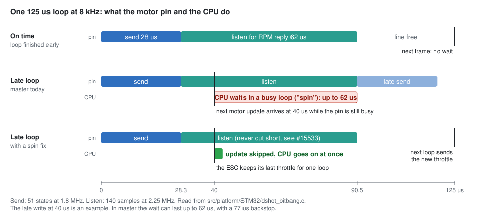

# F722 8 kHz with bidir DShot600: where the performance was found

**Status: agent-built and agent-checked. Not reviewed by a person. Never flown. Bench use only, props off.**

PR #15779 forces DShot300 and a 4 kHz PID loop on F7 when bidirectional DShot is on. This file sums up what
was measured, what was changed, and the "don't spin" fix that targets the cause. How to test it is in
[F722-PERF-TESTING.md](F722-PERF-TESTING.md). The illustrated version of this file is [docs/f722/F722-PERF-FINDINGS.pdf](docs/f722/F722-PERF-FINDINGS.pdf).
Prebuilt test firmware:
[f722-test-900f67102](https://github.com/cyclistmass/betaflight/releases/tag/f722-test-900f67102).

**What "the spin" means.** With bidirectional DShot, each motor pin does two jobs every loop. It sends the
motor frame (28 us), then listens for the ESC's RPM reply (62 us). If the next motor update arrives while the
pin is still listening, today's code makes the CPU wait in a busy loop ("spin") until the listen window closes.
At 8 kHz a loop is 125 us, so one late loop can lose up to 62 us to this wait and miss the next gyro sample.
The "spin fixes" skip that one motor update instead of waiting. The ESC keeps its last throttle for one more
loop, and the CPU goes on at once.

Grades used below: **MEASURED** = ran on the board or in the simulator. **READ** = from source, with file:line.
**HYPOTHESIS** = everything else.

## Bottom line

| | Result | Grade |
|---|---|---|
| PID loop work, all patches | **-12.0 %**: 8,033 -> 7,071 cycles per loop, 5 interleaved board rounds | MEASURED |
| Average CPU at 8 kHz | **~49 % -> ~45 %**: 61.1 -> 56.4 us of a 125 us loop. Measured at 3.2 kHz, projected to 8 kHz | HYPOTHESIS |
| Worst-case loop, don't-spin fix | **~123 -> ~56 us**. A late loop can spin up to 62 us today. The fix removes that wait | HYPOTHESIS |

The patches give back about 5 us per loop. That helps, but the telemetry wait decides whether 8 kHz is safe.
Order of value: the don't-spin fix first, then the cycle savings, then the scheduler headroom.

## What one loop does

1. **Sense.** The gyro raises an interrupt when a sample is ready. DMA copies it over SPI with no CPU.
2. **Clean.** Low-pass filters, a dynamic notch and the RPM filter remove motor and prop noise. The RPM
   filter needs each motor's RPM, which comes from bidir DShot telemetry.
3. **Decide.** The PID controller compares the stick request with the measured rotation.
4. **Mix.** The mixer turns roll, pitch, yaw and throttle into four motor commands.
5. **Act.** Bitbang DShot sends each ESC a 16-bit frame. With bidir on, the same wire then listens for the
   ESC's RPM reply.

At 8 kHz all five steps must fit in 125 us, every time. Other jobs (RC input, OSD, blackbox, battery) fit in
the gaps.

## Board results: all patches together

SpeedyBee F7 V3 (BMI270, 3.2 kHz), USB only, no ESC. DShot600, bidir on, `pid_process_denom = 1`. Cycle counter
averaged over 1,024 calls, 5 interleaved rounds. Base = master + test guard, patched = all of A2-E.

| Stage | Base cycles | Patched | Change | Time |
|---|---|---|---|---|
| Motor update (mixer + DShot write + decode) | 5,793 | 4,868 | -16.0 % | 26.8 -> 22.5 us |
| Telemetry decode | 1,714 | 1,399 | -18.4 % | 7.9 -> 6.5 us |
| Gyro filtering | 4,721 | 4,667 | -1.2 % | 21.9 -> 21.6 us |
| PID controller | 1,566 | 1,550 | -1.0 % | 7.3 -> 7.2 us |
| RC command | 399 | 385 | -3.5 % | 1.9 -> 1.8 us |
| Gyro update | 453 | 447 | -1.3 % | 2.1 -> 2.1 us |
| **Whole PID loop task** | **8,033** | **7,071** | **-12.0 %** | **37.2 -> 32.7 us** |

Decode is counted inside motor update. Gyro filtering is a separate task, so it is not inside the PID loop
total. Changes of about 1 % are inside boot-to-boot noise. MEASURED

## Scheduler pass cost (patch A2)

Same board and settings. A probe counts cycles per scheduler pass and passes per 100 ms. 3 rounds x 1,500
samples. Base spread: 1 cycle, about 14 passes.

| Build | Cycles per pass | vs base | Passes / 100 ms |
|---|---|---|---|
| base | 632 | - | 18,124 |
| A2 (time-driven task age) | 611 | -3.3 % | 19,806 (+9.3 %) |
| Sol 1 (alternative scheduler change) | 630 | -0.3 % | 19,269 (+6.3 %) |
| B / Sol 2 (hold-task checks) | 632 | 0 | 18,116 |

A2 is repeatable: each pass is 21 cycles cheaper, so the scheduler checks for gyro data 9 % more often. B and
Sol 2 show zero because the altitude-hold and position-hold tasks they touch are not enabled on this board.
MEASURED

## Patch by patch

| Patch | What it does | Evidence | Verdict |
|---|---|---|---|
| A2 | Scheduler computes task age from time with one divide. Same priority result as master (checked over 1.3 billion cases) | -3.3 % per pass, +9 % passes | Keep |
| B | Cheaper checks in the hold tasks | No effect here: tasks not running. Needs a GPS/baro setup | Untested here |
| C | Mixer: skips thrust-linear math when it is 0, hoists a failsafe check | No gain on F722 (the compiler already hoists it). Adds a branch when thrust linear is on | Drop (not in any preset) |
| D | Faster bidir telemetry decoder | Simulator: -34 % decoder instructions. Board, 3 rounds: decode -10.5 %, loop -2.7 % | Keep |
| E | Swaps colder code out of ITCM for hotter code (ITCM 15,712 B of 16 KB) | Board, 3 rounds: loop -8.2 %, motor update -10.9 %. The largest single gain | Keep |
| Sol 3 | Replaces the do-nothing filter call for a disabled notch with a NULL check | Board, defaults: loop -2.1 %. Gain only when notches are off | Best case only, not on this branch |
| Sol 5 | Moves the DShot DMA handler and telemetry update into ITCM (ITCM +416 B) | Built, not benched | Candidate, not on this branch |

Upstream issue found on the way: `FAST_CODE_NOINLINE` is not placed in ITCM on STM32 (it expands to
`NOINLINE` only), so `updateDshotTelemetry` runs from flash with 7 wait states. READ, and map file MEASURED.

## Each patch alone on the board

Each build = master + guard + one patch. 3 interleaved rounds x 1,500 samples. Round spread on base: 6 cycles
(loop), 2 (decode).

| Build | PID loop | vs base | Motor update | Decode |
|---|---|---|---|---|
| base | 8,033 | - | 5,794 | 1,713 |
| E (ITCM swap) | 7,376 | -8.2 % | 5,165 (-10.9 %) | 1,563 (-8.7 %) |
| D (decoder) | 7,813 | -2.7 % | 5,589 (-3.5 %) | 1,532 (-10.5 %) |
| A2 (scheduler) | 7,940 | -1.2 % | 5,698 | 1,720 |
| C (mixer) | 7,958 | -0.9 % | 5,702 | 1,712 |
| B (hold checks) | 8,034 | 0.0 % | 5,791 | 1,717 |
| Sol 3 (separate run, its own base 8,032) | 7,863 | -2.1 % | 5,683 | 1,707 |

E and D carry most of the gain. The single-patch savings add to about 1,045 cycles against 962 for all patches
together, so they roughly add up. MEASURED

Read the small numbers with care. The same firmware gives almost the same number every boot, but any rebuild
moves code in flash and changes cache and wait-state behaviour. A2 only touches the scheduler, yet gyro update
moved -8 %. C is a no-op on F722, yet the loop moved -0.9 %. A change of 1-2 % in one stage can be a layout
effect, not the patch. HYPOTHESIS for the cause; the moves themselves are MEASURED.

## Rule from the Betaflight devs: optimize for the worst case

Feedback on patch C: skipping math when a feature is off makes the loop faster only for pilots who do not use
it. It hides the true worst-case loop and adds a small cost for pilots who do. Optimize the worst case, not the
best case.

What we did with it: C is in no preset. Sol 3 is quoted as best case only. The presets keep the patches that cut
work that always runs (A2, D, E). Still to do: bench a worst-case setup (thrust linear on, all RPM harmonics,
dynamic notch) and log the maximum loop time, not only the average.

## The don't-spin fix

This is the change that matters most for 8 kHz. Three model lanes (Opus, GPT 5.6 Sol, Fable) worked the timing
problem independently and ranked the same fix first.

### The problem

After each motor frame, the DShot pins are busy for 90.5 us: 28.3 us sending the frame (51 states at 1.8 MHz),
then 62.2 us listening for the ESC's RPM reply (140 samples at 2.25 MHz). The listen phase cannot be cut short:
aborting it drove the line against a transmitting ESC and corrupted the barometer (#15533).
READ `src/platform/STM32/dshot_bitbang.c`

The diagram at the top of this file shows the timing.

At a steady 8 kHz the line is free 34.5 us before the next frame, so nothing waits. If a loop runs late, the
next write lands while the line is still busy. Today `bbTelemetryWait` spins in flash until the reply ends: up
to 62 us, with a 77 us backstop. Add about 61 us of loop work and a bad loop takes about 123 us, the whole
budget. The next gyro sample is missed, the next loop starts late, and the delay can feed on itself. That is
what #15779 guards against. HYPOTHESIS for the feedback effect; the spin itself is READ.

### The fix

- Before touching the buffers, check whether the previous frame still owns the line (sending or listening).
- If it does, mark this frame deferred and return at once. Leave the buffers, the telemetry request and the
  DShot command queue untouched for the next loop.
- The ESC keeps its previous throttle for one more 125 us loop. ESC signal timeouts are in milliseconds.
- The reply is never aborted, so #15533 stays fixed. A stream stuck past the guard is reset the same way the
  old backstop did.
- It also closes a second bug: two writes less than 28 us apart used to rewrite the output buffer while DMA was
  still sending it.

Worst-case loop: about 123 us today, about 56 us with the fix and the patches. HYPOTHESIS

### Three independent versions

| Switch | Version | How it decides the line is busy | ITCM |
|---|---|---|---|
| `DSHOT_BB_NOSPIN_OPUS` (=1) | Opus | New `bbTelemetryBusy()`, busy also during the send phase | +80 B |
| `DSHOT_BB_NOSPIN_SOL` (=2) | GPT 5.6 Sol | Age from the last send, 105 us guard, marks stalled captures for reset | +32 B |
| `DSHOT_BB_NOSPIN_FABLE` (=3) | Fable | `bbLineBusy()` also checks the DMA stream; counts deferred frames in `DSHOT_TELEMETRY_COUNTS` debug[4] | +176 B |

All three change only `src/platform/STM32/dshot_bitbang.c`. No unit test covers the bitbang driver itself.

### What it does not do

- It does not reduce CPU load. It turns a 0-77 us spin into one skipped motor update.
- If loops stay closer than 90.5 us for a long stretch, the motor update rate halves. The probe counts deferred
  frames so this can be seen.
- Other platforms (APM32, AT32, GD32, X32) keep the spin.

## How each number was measured

| Number | Method |
|---|---|
| Stage cycles (PID loop, motor update, decode, filters) | A TEST ONLY build reads the CPU cycle counter before and after each stage, averages 1,024 calls, and puts the result in `debug[]`. A script reads it over MSP with `debug_mode = NONE`. Each build is flashed by DFU with a full erase. Rounds are interleaved (base, patched, base, ...) so drift hits both equally. 216 MHz converts cycles to us. |
| Scheduler pass cost (A2) | Same method around the task-priority loop in `scheduler()`, plus a count of scheduler passes per 100 ms. 3 rounds x 1,500 samples. |
| Same output as master | Disassembly of the whole firmware with the revision string pinned, compared line by line. 0 differing lines means the same machine code. A2's priority result was also compared with master on 1.3 billion host cases. |
| Flight behaviour | SimITL runs the real firmware as SITL against a simulated quad and a scripted flight. Traces, CLI output and blackbox must be byte-identical to master. Deliberate small breaks must change them, which proves the test can see a change. |
| Decoder correctness (D) | New and old decoder decode the same input: a 2,209-frame corpus and 20 million random buffers, 0 mismatches. |
| The spin and the 62 us window | Read from the driver: 51 output states at 1.8 MHz and 140 input samples at 2.25 MHz. Not yet measured at 8 kHz. The `DSHOT_BB_PROBE` build measures it on a board. |

Bench scripts and raw results: branch `f722-bidir-bench`, folder `bench/f722`.

## Build switches: what each one buys

All off = master. Turn them on with `make CONFIG=<board> EXTRA_FLAGS="-D<switch> ..."`. Definitions are in
`src/main/build/perf_switches.h`. Savings are PID-loop cycles on the SpeedyBee F7 V3 (base 8,033 cycles =
37.2 us) unless the row says otherwise.

| Switch | Patch | Estimated saving | Where it came from |
|---|---|---|---|
| `PERF_ALL` | Loop fixes + spin fix | Average: loop -12 %, ~4.7 us per loop. Worst case: ~123 -> ~56 us | Loop: board, 5 rounds MEASURED. Worst case: code reading HYPOTHESIS |
| `PERF_LOOP` | A2 + B + D + E | Loop -12.0 % (8,033 -> 7,071). CPU at 8 kHz ~49 % -> ~45 % | Board, 5 rounds MEASURED; 8 kHz share projected HYPOTHESIS |
| `PERF_NOSPIN` | Spin fix only (Fable unless one is named) | Removes up to 62 us of spin (77 us backstop) from a late loop | Timing from source constants READ; not yet measured at 8 kHz |
| `PERF_SCHED_TASK_AGE` | A2 | -21 cycles per scheduler pass (-3.3 %), +9.3 % passes | Board probe, 3 rounds MEASURED; same output as master on 1.3 billion cases and in the simulator |
| `PERF_HOLD_TASK_SIGNAL` | B | 0 on a quad without GPS/baro hold | Board probe shows 0 here MEASURED |
| `PERF_MIXER` | C (in no preset) | ~0 on F722. Best case only | Disassembly: compiler already hoists it MEASURED |
| `PERF_BB_DECODE` | D | Decode -10.5 %, loop -2.7 % | Board, 3 rounds MEASURED; simulator -34 % instructions, 20 M fuzz buffers 0 mismatches |
| `PERF_BB_ITCM` | E | Loop -8.2 %, motor update -10.9 %. Largest single gain | Board, 3 rounds MEASURED; no ITCM in SITL |
| `DSHOT_BB_NOSPIN_OPUS` / `_SOL` / `_FABLE` | Spin fixes | Same target as `PERF_NOSPIN` | Built, booted on SpeedyBee (smoke test). Not tested at 8 kHz |
| `DSHOT_BB_PROBE` | TEST ONLY timing probe | - | Builds on every platform. Not yet run on a board |

Take one patch out of a preset with `-DNO_PERF_<name>`, or keep the spin with `-DDSHOT_BB_NOSPIN=0`. Naming two
spin fixes is a build error. To run 8 kHz with bidir on F722, also add the TEST ONLY
`-DTEST_UNGATE_PID_DENOM_CHECK`, which lifts the #15779 downgrade. Never release it.

## How the switches were checked

| Check | Result |
|---|---|
| Builds: every preset, every single switch, presets with each patch taken out, SpeedyBee F7 V3 and GEPRC F722 | All build. Two spin fixes at once, or a bad value, stop the build with a clear error |
| Every spin fix with the probe on, `-Werror`: F405, F411, F722, G474, H743, AT32F435, APM32F405, GD32H757, X32M7, SITL | All build |
| Betaflight CI (clang, every SDK and target, `checks`, `test-all`) on commit 900f67102 | 54 of 54 jobs pass |
| Same machine code (revision pinned): switches off vs master; `PERF_LOOP`+`PERF_MIXER` vs the patch branch; `PERF_ALL`+`PERF_MIXER`+Opus vs the Opus tree; probe off vs master | Identical, 0 lines. Controls (A2 on, probe on) differ |
| Unit tests, switches off and as `.perf` variants with them on (scheduler, althold, poshold, autopilot_wing) | All pass. Same result as master |
| Simulator, calm scripted flight (arm, stick work, 20-60 % throttle, RC loss with auto-land, re-arm): A2, C, D vs switches off, thrust linear 0 and 25 | 21/21 identical. D on the bitbang sim with 0 % and 20 % damaged replies: 4/4 identical |
| Simulator, rough flight (seeded gusts, punch-outs, flips, airmode chops, motor imbalance, battery sag) | 8/8 identical over 304,038 scheduler passes each |
| Red controls that must differ: old patch A, a deliberate +1 in the mixer, a bit-flip in the decoder, a different gust seed | All differ, so the comparisons can see a change |
| Board smoke test, SpeedyBee F7 V3, all five test builds | All boot, keep DShot600, bidir and denom 1. 0 reception timeouts. Fable deferred 3 frames |

The simulator cannot show speed, ITCM placement (E) or DMA timing (the spin fixes). Those need a board.

## Open questions

- **Shared DMA2.** On F722 the gyro SPI DMA and the bitbang DMA share the DMA2 controller. On F4, Betaflight
  keeps SPI DMA off DMA2 with bitbang because of an errata item. The F7 code has no such guard. The F72x errata
  sheet (ES0360) is not yet checked. HYPOTHESIS
- **Decode race.** Decoding the last reply runs while the next capture starts filling the same buffer 28 us
  later. If decode takes longer than that, RPM telemetry (not gyro data) is corrupted. Patch D shrinks the risk.
  HYPOTHESIS
- **Worst-case bench.** Thrust linear on, all RPM harmonics, dynamic notch on, with maximum loop time logged.
- **8 kHz hardware.** The spin and the fixes need an F722 with an 8 kHz gyro (ICM-42688P, ICM-20602, MPU6000).
  The SpeedyBee's BMI270 runs at 3.2 kHz, so its 312 us loop never meets the 90.5 us busy window.

## Where the work lives

- This branch, with build switches: `cyclistmass/betaflight` `f722-bidir-switchable`
- Patches, one commit each: `cyclistmass/betaflight` `f722-bidir-perf`
- Bench scripts and raw results: `cyclistmass/betaflight` `f722-bidir-bench`
- Rule being lifted: betaflight #15779. Capture-abort history: #15533

— Cyclistmass
